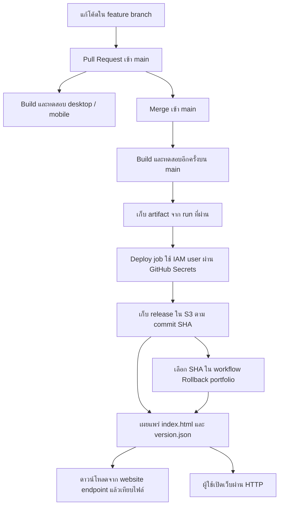

# Static Portfolio CI/CD on AWS S3

เว็บเรซูเม่ภาษาไทยของ Supasek Sangket สำหรับฝึกทำ CI/CD ตั้งแต่การทดสอบบนเบราว์เซอร์ การ deploy ไปยัง AWS S3 ไปจนถึงการย้อนกลับไปใช้ release ที่เคยผ่านการทดสอบแล้ว

[เปิดเว็บไซต์](http://supasek-portfolio-001-461899883996-ap-southeast-2-an.s3-website-ap-southeast-2.amazonaws.com/) · [ดูเวอร์ชันบนเว็บ](http://supasek-portfolio-001-461899883996-ap-southeast-2-an.s3-website-ap-southeast-2.amazonaws.com/version.json) · [ดู GitHub Actions](https://github.com/MixSupasek/static-port/actions)

## สถาปัตยกรรม



| ส่วน | เทคโนโลยีและหน้าที่ |
| --- | --- |
| เว็บไซต์ | HTML และ CSS ใน `index.html` |
| Build | Node.js สร้างชุดไฟล์ใน `dist/` พร้อมข้อมูลเวอร์ชัน |
| Automated testing | Playwright และ Chromium ที่ขนาด desktop กับ mobile |
| CI/CD | GitHub Actions ติดตั้ง dependency, build, test และ deploy |
| Hosting | Amazon S3 Static Website Hosting ใน `ap-southeast-2` |
| สิทธิ์ deploy | IAM user สำหรับ bucket นี้ และ Access Key ใน GitHub Secrets |
| ประวัติ release | Git commit SHA, โฟลเดอร์ `releases/` และ S3 Versioning |

ตั้ง branch protection ของ `main` ให้ต้องเปิด Pull Request และผ่าน check `test` ก่อน merge พร้อมบังคับให้ branch อัปเดตตาม `main`

## โครงสร้างไฟล์

```text
index.html                    เนื้อหาและรูปแบบเว็บไซต์
package.json                  คำสั่ง npm และเลขเวอร์ชัน
package-lock.json             เวอร์ชัน dependency สำหรับ npm ci
scripts/build.mjs             สร้างไฟล์เว็บไซต์และ version.json
playwright.config.js          ตั้งค่าเบราว์เซอร์ ขนาดหน้าจอ และ local server
tests/portfolio.spec.js       ทดสอบเว็บไซต์ 4 เรื่องบน 2 ขนาดหน้าจอ
.github/workflows/ci.yml      Build, test และ deploy
.github/workflows/rollback.yml เรียกคืน release จาก S3
```

## รันในเครื่อง

ติดตั้ง Git และ Node.js 24 ขึ้นไป แล้วเปิด terminal

```powershell
git clone https://github.com/MixSupasek/static-port.git
cd static-port
npm ci
npx playwright install chromium
npm run build
npm test
npm start
```

เปิด [เว็บไซต์ในเครื่อง](http://127.0.0.1:4173) และกด Ctrl+C เพื่อหยุด server

แก้เนื้อหาใน `index.html` หรือเลขเวอร์ชันใน `package.json` แล้วรัน `npm run build` ก่อนทดสอบอีกครั้ง เพื่อให้ `dist/` เป็นชุดไฟล์ล่าสุด

## Automated testing

`npm test` รัน 4 เคสบน desktop และ mobile รวม 8 เคส

| เคส | สิ่งที่ตรวจ |
| --- | --- |
| หน้าแรก | HTTP 200 ชื่อเจ้าของเว็บ และหัวข้อโปรเจกต์ครบทั้งสี่รายการ |
| ลิงก์ | อีเมลและโทรศัพท์ตรงกับข้อมูลติดต่อ พร้อมตรวจรูปแบบ URL ของ GitHub repository |
| Responsive layout | ความกว้างเนื้อหาพอดี viewport โดยไม่มี horizontal overflow |
| ข้อมูล release | `/version.json` ระบุ commit ที่ใช้ build เลขเวอร์ชัน และวันที่ build ที่อ่านได้ |

ผลการทดสอบแสดงใน terminal และ HTML report เปิดได้ด้วย `npx playwright show-report`
เมื่อทดสอบล้มเหลว Playwright เก็บ screenshot และ trace ไว้ช่วยวิเคราะห์
การตรวจลิงก์ครอบคลุมค่าปลายทางในหน้าเว็บ ส่วนสถานะ HTTP ของ GitHub ปลายทางอยู่นอกขอบเขตชุดทดสอบนี้

## ตั้งค่า AWS และ GitHub

โปรเจกต์นี้ใช้ bucket `supasek-portfolio-001-461899883996-ap-southeast-2-an` ใน Region `ap-southeast-2`

1. เปิด S3 Static website hosting และกำหนด Index document เป็น `index.html`
2. เปิด S3 Versioning และใช้ encryption แบบ SSE-S3
3. ตั้ง Block Public Access และ bucket policy ให้ผู้ใช้ทั่วไปอ่าน object ของเว็บไซต์ได้
4. สร้าง IAM user `github-static-port-deploy` พร้อม policy จำกัด bucket
5. สร้าง Access Key แล้วบันทึกใน repository ที่ Settings → Secrets and variables → Actions

| Repository secret | ค่าที่ใช้ |
| --- | --- |
| `AWS_ACCESS_KEY_ID` | Access key ID ของ user สำหรับ deploy |
| `AWS_SECRET_ACCESS_KEY` | Secret access key ของ user สำหรับ deploy |

สิทธิ์ IAM ที่ workflow ใช้มีดังนี้

| Resource | Actions |
| --- | --- |
| `arn:aws:s3:::supasek-portfolio-001-461899883996-ap-southeast-2-an` | `s3:ListBucket`, `s3:GetBucketLocation` |
| `arn:aws:s3:::supasek-portfolio-001-461899883996-ap-southeast-2-an/*` | `s3:GetObject`, `s3:PutObject` |

เมื่อทำซ้ำในบัญชีอื่น ให้เปลี่ยน `S3_BUCKET`, `AWS_REGION` และ `WEBSITE_URL` ใน workflow ทั้งสอง รวมถึง Resource ใน IAM policy ให้ตรงกับ bucket ใหม่
เก็บ Access Key ใน GitHub Secrets และเปลี่ยนหรือเพิกถอนคีย์เมื่อเลิกใช้งาน

## การทำงานของ CI/CD

Workflow `Portfolio CI/CD` เริ่มเมื่อ push เข้า `main` หรือ `codex/**`, เปิดหรืออัปเดต Pull Request เข้า `main` และเมื่อสั่ง Run workflow

1. ติดตั้ง dependency จาก lockfile ด้วย `npm ci`
2. Build `dist/index.html` และ `dist/version.json`
3. รัน Playwright ทั้ง 8 เคส
4. เก็บ artifact ชื่อ `website-<commit SHA>` หลังทดสอบผ่าน และเก็บ HTML test report ไว้ 7 วัน
5. สำหรับ push หรือ Run workflow บน `main` ให้ deploy job ดาวน์โหลด artifact จาก run เดียวกัน
6. ตรวจว่า commit ที่กำลัง deploy ยังเป็น commit ล่าสุดของ `main`
7. เก็บไฟล์ทั้งสองใน `releases/<commit SHA>/` แล้วอัปโหลดไปที่ราก bucket พร้อม `Cache-Control: no-store`
8. ใช้ `curl` ดาวน์โหลดไฟล์จาก website endpoint แล้วใช้ `cmp` เทียบกับไฟล์ที่ผ่านการทดสอบ

ดูผลได้ใน Actions → เลือก run → job `test` หรือ `deploy`
เมื่อ deploy สำเร็จ Summary จะแสดง `Deployed <SHA> to <URL>`

## Versioning และการปล่อยเวอร์ชัน

เลข release มาจาก `version` ใน `package.json` ส่วน `revision` ใช้รหัส Git commit เต็ม 40 ตัว
CI รับรหัสผ่าน `GITHUB_SHA` และการ build ในเครื่องอ่านจาก `git rev-parse HEAD`

ตัวอย่าง metadata ของ release ที่ทดลอง deploy สำเร็จ

```json
{
  "version": "1.1.0",
  "revision": "31877819279f57a8cbb9a2eea1e65c327678cb8a",
  "builtAt": "2026-11-25T07:22:19.413Z"
}
```

เมื่อต้องการปล่อยเวอร์ชันใหม่ ให้สร้าง feature branch แก้เว็บไซต์และเลขเวอร์ชัน เปิด Pull Request แล้วตรวจ CI ก่อน merge เข้า `main`
Pipeline จะทดสอบและ deploy commit ที่ merge โดยอัตโนมัติ

`releases/<SHA>/` ใช้เลือกชุดไฟล์สำหรับ rollback ส่วน S3 Versioning เก็บประวัติ object ที่ถูกเขียนทับ
ข้อมูล release ใน S3 เก็บตามการตั้งค่า bucket ส่วน GitHub artifacts มีอายุ 7 วัน

## Rollback

1. หา SHA ของ release ที่เคย deploy สำเร็จ จาก `version.json` ที่เก็บไว้ หรือ Summary ของ deploy run
2. เปิด Actions → `Rollback portfolio` → Run workflow
3. เลือก branch `main` และใส่ SHA เต็ม 40 ตัวในช่อง `revision`
4. Workflow ดาวน์โหลด `index.html` และ `version.json` จาก `releases/<SHA>/` แล้วตรวจว่า metadata ตรงกับ SHA ที่เลือก
5. อัปโหลดไฟล์คืนไปที่ราก bucket แล้วตรวจไฟล์บนเว็บไซต์ด้วย `curl` และ `cmp`
6. เปิดเว็บไซต์และ `/version.json` เพื่อตรวจผล

การทดลองย้อนกลับไป `1.0.0` ใช้ SHA นี้

```text
6b59bb44a7eb6e8af59be66049cf14dc193d9a1b
```

SHA ของ release ที่ต้องการอยู่ในช่อง input `revision` ส่วน commit ที่แสดงตรงหัว rollback run คือโค้ด workflow บน `main` ที่รันงานนั้น
Rollback เปลี่ยนไฟล์ที่เผยแพร่บน S3 โดยโค้ดใน `main` ยังคงอยู่ที่ commit เดิม
การ deploy จาก `main` ครั้งถัดไปจะเผยแพร่โค้ดบน `main` อีกครั้ง

Deploy และ rollback ใช้ concurrency group `portfolio-production` ร่วมกันเพื่อให้เผยแพร่ทีละชุด
ไฟล์ HTML และ metadata อัปโหลดแยกกัน หากงานล้มเหลวระหว่างอัปโหลด ให้แก้สาเหตุแล้วรัน workflow ที่ต้องการซ้ำ พร้อมตรวจขั้น Verify จนผ่าน

## หลักฐานการทดลอง

ทดลองบน AWS จริงเมื่อ 25 พฤศจิกายน 2569

| ขั้นตอน | ผล | หลักฐาน |
| --- | --- | --- |
| ปล่อย `1.0.0` | Test และ deploy ผ่าน | [Deploy run](https://github.com/MixSupasek/static-port/actions/runs/45566052953) |
| แก้หน้าเว็บและปล่อย `1.1.0` | Test และ deploy ผ่าน | [Deploy run](https://github.com/MixSupasek/static-port/actions/runs/45567590854) |
| ย้อน `1.1.0` กลับ `1.0.0` | Rollback และตรวจไฟล์เว็บผ่าน | [Rollback run](https://github.com/MixSupasek/static-port/actions/runs/45568797481) |

ตรวจหลัง rollback แล้ว หน้าแรกและ `version.json` ตรงกับไฟล์ใน release `1.0.0` ทั้งสองไฟล์
สถานะเว็บไซต์ปัจจุบันดูได้จากลิงก์ version ด้านบน และหลักฐานในตารางอ้างอิงการทดลองแต่ละรอบ

## ขอบเขตและข้อจำกัด

- Website endpoint ของ S3 ใช้ HTTP และไฟล์เว็บไซต์รวมถึง release ที่เปิดสิทธิ์อ่านเป็นข้อมูลสาธารณะ
- บัญชีที่ใช้ทดลองติดเงื่อนไขตรวจสอบบัญชีก่อนสร้าง CloudFront และหน้า Identity providers ต้องเปิด Advanced features จึงใช้ IAM user กับ GitHub Secrets สำหรับ deploy
- Pipeline รองรับชุดไฟล์ `index.html` กับ `version.json` หากเพิ่มไฟล์ CSS, JavaScript หรือรูปแยก ต้องปรับ build, deploy, rollback และการตรวจไฟล์ให้ครอบคลุม
- ตั้ง branch protection บน `main` ให้ต้องผ่าน Pull Request และ check `test` รวมถึงอัปเดต branch ให้ทัน `main` ก่อน merge โดยบังคับใช้กับผู้ดูแลและปิด force push กับการลบ branch
- ค่าใช้จ่ายขึ้นกับ S3 storage, requests และ data transfer รวมถึงสิทธิ์และเครดิต Free plan ของบัญชี ตรวจเครดิตใน AWS Settings หรือ Billing และจัดการประวัติ release เมื่อเลิกใช้

## เอกสารอ้างอิง

- [Amazon S3 Static Website Hosting](https://docs.aws.amazon.com/AmazonS3/latest/userguide/HostingWebsiteOnS3Setup.html)
- [การตั้งสิทธิ์อ่านเว็บไซต์ S3](https://docs.aws.amazon.com/AmazonS3/latest/userguide/WebsiteAccessPermissionsReqd.html)
- [AWS credentials action](https://github.com/aws-actions/configure-aws-credentials)
- [GitHub Actions Secrets](https://docs.github.com/en/actions/how-tos/write-workflows/choose-what-workflows-do/use-secrets)
- [Playwright บน CI](https://playwright.dev/docs/ci-intro)
- [AWS Free Tier](https://aws.amazon.com/free/free-tier-faqs/)
